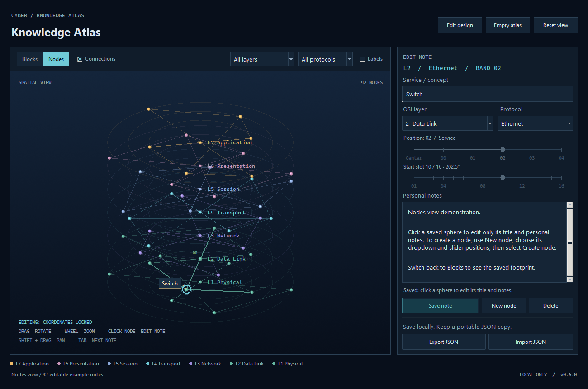

# Cyber Atlas

**Cyber Atlas** is a desktop notebook that organizes knowledge in a 3D map. Explore your notes as nodes or blocks, arrange them into custom layers, and add your own explanations. Start with a built-in template or create an empty atlas.

Group related types into **orbital subconcepts**, each with its own notes. Nodes view expands the cluster; Blocks view keeps the parent and its child list.

Your notes work offline and stay on your computer. You can export and import atlases as JSON files. Use **Updates** to check for new releases; optional daily checks contact GitHub, and downloads start only when you choose them.

See the [user guide](docs/USER_GUIDE.md) for controls and saving, or the [developer guide](docs/DEVELOPMENT.md) for source setup and builds.

## Install Cyber Atlas

Choose a package for **version 0.8.0**. Each **Download** link downloads the selected file.

| Platform | Package | Installation |
| --- | --- | --- |
| Windows 10/11 (x64) | **[Download installer (.exe)](https://github.com/seiejouke/cyber_atlas/releases/download/v0.8.0/CyberAtlas-0.8.0-Setup.exe)** | Open it and follow the installer. |
| Ubuntu / Debian (x86_64) | **[Download package (.deb)](https://github.com/seiejouke/cyber_atlas/releases/download/v0.8.0/cyber-atlas_0.8.0_amd64.deb)** | Open it with your software installer. |
| Other compatible Linux (x86_64) | **[Download AppImage](https://github.com/seiejouke/cyber_atlas/releases/download/v0.8.0/CyberAtlas-0.8.0-x86_64.AppImage)** | In the file's properties, allow it to run as a program, then open it. |

See the [release notes and checksums](https://github.com/seiejouke/cyber_atlas/releases/tag/v0.8.0) and the [user guide](docs/USER_GUIDE.md#install-and-open) for system requirements and installation details.

---

## Orbital clusters

Select a saved node and choose **+ Subconcept** to create a related type with
independent notes. Each parent supports one ring of eight stable local positions.
**Expand** and **Focus cluster** make the children easy to explore; **Show atlas**
returns to the surrounding map. Moving the parent carries its children along.

In Blocks view, select a child in **Subconcepts** to edit its notes, or choose
**Explore in Nodes** to open the orbit. Children share their parent's layer and
protocol filters and are included in JSON exports and backups.
Try the [editable orbital-cluster example](examples/orbital_cluster_atlas.json).

## Project scope and vision

This section contains the complete illustrated design philosophy. The current
release provides the spatial notebook foundation; information and mastery
measurements, assessments, source integration and historical
playback remain planned capabilities. The implementation table below records
what is available today.

### Contents

- [Product vision](#product-vision)
- [Spatial information model](#spatial-information-model)
- [Ten fundamental design principles](#ten-fundamental-design-principles)
- [Cumulative source integration](#underlying-requirement-cumulative-source-integration)
- [Four complementary dimensions](#four-complementary-dimensions)
- [Current implementation and planned features](#alpha-implementation-versus-planned-features)
- [Central design philosophy](#central-design-philosophy)

> **Product vision and fundamental architecture**  
> **Development stage:** Alpha · **Reference implementation:** v0.8.0 · **Updated:** 25 October 2026

### Product vision

**Cyber Atlas is a spatial learning companion designed to transform fragmented information into a coherent, interconnected, and progressively consolidated body of knowledge.**

Inspired by the Munsell Colour System and the idea of a digital memory palace, it organizes knowledge within an evolving three-dimensional structure. Rather than merely collecting notes, the atlas aims to communicate **where new information belongs, how it relates to existing concepts, how much information has accumulated, how well it is retained, and how understanding changes over time**.

Its core motivation is **cumulative knowledge integration**: reading a page today, finding a related idea next week, or reading seven books on one topic should contribute to one developing structure instead of seven disconnected note collections. A fragment does not need an immediate connection; it should remain available for future integration.

### Spatial information model

| Dimension or feature | Intended meaning |
| --- | --- |
| **Vertical axis (Z)** | Major knowledge categories or conceptual layers |
| **Radial distance** | Increasing granularity, function, or detail |
| **Angular position** | Deliberate, recognizable spatial placement |
| **Local orbit** | Sibling types or variants grouped around a parent concept |
| **Outer node shell** | Relative quantity of accumulated, distinct information |
| **Inner node core** | Estimated mastery based on demonstrated retrieval and application |
| **Connections** | Explicit conceptual or structural relationships |
| **Time** | How the atlas and understanding have changed |
| **Source references** | Where a claim or observation originated and what it contributed |

*Figure: Spatial architecture with central conceptual layers and outward radial progression.*

### Ten fundamental design principles

#### 01. Spatial knowledge organization

Concepts occupy meaningful positions in a configurable three-dimensional atlas. An OSI atlas, for example, can use major layers as central pillars, associated protocols as nearby radial concepts, and services or mechanisms farther outward. The same coordinate system should also accommodate Python, mathematics, biology, and other topics.

**Principle:** Spatial position can act as a durable organizational reference and potentially as an additional memory-retrieval cue. A concept may belong to more than one category; the system should support cross-category references rather than forcing an inaccurate classification.

#### 02. Relative information volume

Nodes expand as they accumulate *distinct, useful information*. Relative size communicates where a learner has concentrated their study. Repeating the same explanation across several sources should not automatically produce the same apparent growth as adding new concepts.

Size should use a bounded, nonlinear scaling function so that a few information-heavy nodes do not dominate the atlas. The choice of information-volume metric is a design question, not an established fact.

**Principle:** The distribution of recorded information should be legible at a glance, without confusing quantity with competence.

#### 03. Dual-shell knowledge representation

Each node has two independently derived visual states:

- **Outer shell — information:** how much distinct material has accumulated.
- **Inner core — mastery:** the extent to which relevant knowledge has been demonstrated through assessments.

*Figure: Dual-shell node: information volume and independent mastery core.*

The space between them represents content not yet demonstrated as mastered, but this should **not** conflate *untested*, *tested incorrectly*, and *once mastered but now poorly retained*. These may need distinct indications. Adding new notes can grow the outer shell immediately without automatically increasing mastery.

**Principle:** A large knowledge record is not necessarily a well-understood concept.

#### 04. Question-driven knowledge assessment

A node can contain or reference questions tied to specific concepts, explanations, comparisons, and examples. Assessment should eventually cover recall, explanation in the learner's own words, and practical application.

Repeated answers, question coverage, difficulty, and time since review inform an estimated mastery state. An absence of testing is **unknown mastery**, not proof of weak understanding.

**Principle:** The system evaluates demonstrated learning rather than inferring understanding from note length or exposure alone.

#### 05. Adaptive knowledge consolidation

When a large node repeatedly produces weak retrieval results, Cyber Atlas should help the learner diagnose the problem. Two principal options are:

1. **Simplification:** remove redundancy, clarify terms, or restructure explanations while preserving essential meaning.
2. **Decomposition:** split an overloaded topic into smaller, related nodes that can be learned and assessed independently.

Weak answers can also result from missing prerequisites, unsuitable questions, or insufficient review. Structural edits should be recommended, not performed destructively without the learner's consent.

**Principle:** Optimize for understandable and retrievable information, not maximum density or minimum node count.

#### 06. Spatial consistency

Node coordinates should remain recognizable while their content and mastery change. A growing node changes its visual state rather than causing the entire atlas to rearrange itself. If a concept splits into subtopics, the original parent should remain a stable anchor wherever possible.

**Principle:** The atlas may evolve without repeatedly disrupting the user's spatial mental model.

#### 07. Continuous learning feedback

The intended loop is **capture → integrate → expand → assess → consolidate → adapt**, repeated as the learner encounters more information.

*Figure: Learning loop from capture through adaptation and continued study.*

Assessment results can update mastery estimates and trigger review or restructuring suggestions. New information should be linked to concepts already present instead of automatically creating a new isolated note.

**Principle:** Knowledge accumulation and knowledge consolidation are part of one iterative process.

#### 08. Temporal knowledge evolution

Cyber Atlas should retain an auditable record of meaningful changes and reconstruct the atlas at previous points in time. Users should be able to scrub a timeline or accelerate playback to see new nodes appear, information shells grow, mastery change, and concepts split or become connected.

*Figure: Sequence of historical atlas snapshots.*

The long-term implementation could store timestamped events together with occasional snapshots. This is separate from the current one-version backup and should not overwrite historical learning data.

**Principle:** Users should be able to observe not only their current knowledge structure but how it developed.

#### 09. Interactive highlighted notes and guided learning flows

Selecting a node should open a structured, readable study view rather than only unformatted notes. A study view can include definitions, mechanisms, examples, comparisons, and active-recall prompts.

A **single comparative note may reference several atlas nodes**. For example, a note explaining packet-filtering, stateful-inspection, proxy, and next-generation firewalls could let the learner click a type and highlight or focus its corresponding node in 3D. The same content should remain available for editing.

*Figure: User-supplied example of a structured comparative firewall study note.*

**Principle:** A note provides *internal instructional structure*; the atlas provides *external spatial structure*. The two should be interactive and mutually reinforcing.

#### 10. Orbital subconcept clusters

Not all specialization should consume another outward radial position. Cyber Atlas distinguishes:

- **Outward expansion:** progressively deeper mechanisms, services, or levels of detail.
- **Orbital expansion:** close sibling variants or subtypes that share one parent concept.

A **Firewall** node might have four smaller nodes orbiting it: *Packet Filtering*, *Stateful Inspection*, *Application Proxy*, and *Next-Generation Firewall*.

*Figure: Four firewall subtypes orbit a central firewall concept.*

These are **types of firewall**, not four successive radial stages. Their relation to the parent should be explicit in the data model, not inferred solely from proximity. Orbital placement should account for overlap, legibility, and the user's stable spatial memory.

**Principle:** Granularity and categorical variation need distinct spatial representations.

### Underlying requirement: cumulative source integration

A learner may read seven books about TCP, encounter the same mechanism repeatedly, and discover contradictory explanations. Cyber Atlas should let those encounters reinforce, extend, clarify, or challenge **one shared concept**.

*Figure: Seven books contribute to one shared TCP knowledge structure.*

A useful future information model distinguishes:

| Element | Responsibility |
| --- | --- |
| **Source** | Book, page, article, course, exercise, or observation |
| **Extract** | What was learned from that source |
| **Concept / Node** | The continuing subject represented spatially |
| **Relationship** | How an extract or concept reinforces, depends on, contrasts with, or contradicts another |
| **Assessment** | Evidence of understanding and retention |
| **History** | When contributions and structural changes occurred |

Source count, information volume, and mastery are related but **different quantities**. A learner who records the same fact from seven books has encountered seven sources, not necessarily seven new ideas or seven demonstrations of mastery.

An **inbox / unplaced** state should allow observations to remain accessible before a suitable conceptual relationship becomes clear.

### Four complementary dimensions

*Figure: Four dimensions: Space, Volume, Mastery, and Time.*

**Space:** Where does this information belong?  
**Volume:** How much distinct material have I accumulated?  
**Mastery:** How much can I demonstrate I understand and retain?  
**Time:** How has that structure and understanding changed?

Sources, relations, assessments, and interactive study notes connect these dimensions into one learning environment.

### Alpha implementation versus planned features

*Implementation status checked against v0.8.0 on 25 October 2026. Planned capabilities below describe the intended system.*

| Component | Status |
| --- | --- |
| Configurable 3D spatial architecture | **Implemented** |
| Blocks and Nodes visualizations | **Implemented** |
| Stable node coordinates and manual movement | **Implemented** |
| Editable layers, protocols, labels, and templates | **Implemented** |
| Local notes, JSON import/export, atomic saves, one-version backup | **Implemented** |
| Windows and Linux release packaging | **Implemented** |
| Opt-in release checks and verified update downloads | **Implemented** |
| Basic proximity-derived node connections | **Implemented** |
| Distinct-information-based node scaling | **Planned** |
| Dual-shell mastery visualization | **Planned** |
| Node-associated question bank and assessment history | **Planned** |
| Source-aware integration and typed relationships | **Planned** |
| Adaptive simplification and decomposition suggestions | **Planned** |
| Historical playback and timeline | **Planned** |
| Interactive comparative study notes | **Planned** |
| Orbital subconcept clusters | **Implemented** — one ring of eight stable positions, independent notes, Nodes expansion and Blocks child list |

The present alpha establishes the spatial notebook. The envisioned learning mechanisms, including mastery estimates and the proposed memory benefits of spatial association, still require implementation and validation with actual learners.

### Central design philosophy

**Every piece of information should have the opportunity to contribute to a greater whole — and that whole should remain spatially understandable as it grows.**

In Cyber Atlas, a node is not merely a note. It is a spatially located concept that can gather information from multiple sources, develop subtypes and relationships, support questions, reflect demonstrated mastery, and reveal its own evolution over time.

The ultimate objective is not to maximize the quantity of notes. It is to help learners **integrate fragmented information into coherent, accessible, and increasingly well-retained understanding**.

---

**Project:** [seiejouke/cyber_atlas](https://github.com/seiejouke/cyber_atlas)  
**Reference release:** [v0.8.0](https://github.com/seiejouke/cyber_atlas/releases/tag/v0.8.0)  
**Document:** Conceptual product specification; not a claim of scientific efficacy or completed functionality.
