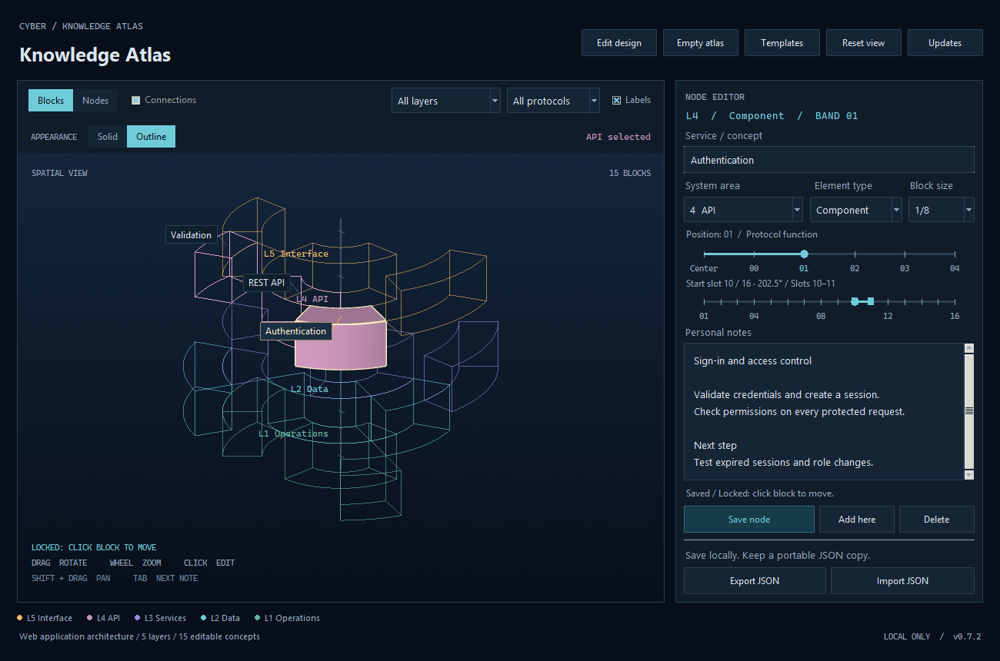

# Cyber Atlas

A local Python desktop notebook built around your Munsell-inspired design.

**Height = your chosen layer. Radius = detail position. Choose Blocks or Nodes to view the same atlas.**
Blocks is the default view. Choose 1/16, 1/8 or a larger fraction of the circle for each block. Blocks
keep their size and position when others are added or removed. Only occupied
space is drawn. Center is an optional radial position with the same controls.
Protocol is an optional block property. The seven-layer OSI design is the starting preset;
layers, protocols, colors, field names and block labels are editable.



## Start here

Use a 64-bit CPython installation. This build was tested with **Python 3.12.3**
on Windows; the original build also ran on Python 3.13 on Linux.
You need Tkinter and a working graphical desktop/OpenGL driver.

This build uses **Tkinter for the interface and VTK for 3D rendering**. It does
not need PySide6, PyVista, a browser, JavaScript, a server, or an API key.
VTK is a substantial download; the source archive does not bundle its wheels.
After dependencies are installed, the app works offline.

Extract the archive, then open a terminal **inside the `cyber_atlas` folder**.

### Windows / PowerShell

```powershell
python -m venv .venv
.\.venv\Scripts\python.exe -m pip install -r requirements.txt
.\.venv\Scripts\python.exe main.py
```

This does not activate a PowerShell script, so it does not require an
execution-policy change. Once setup is complete, `run.bat` starts the app.

### Linux / Arch / macOS

```bash
python3 -m venv .venv
.venv/bin/python -m pip install -r requirements.txt
.venv/bin/python main.py
```

Once setup is complete, `sh run.sh` starts the app.

On Arch, missing Tk support can be installed with:

```bash
sudo pacman -S --needed tk
```

Check your Tk installation with `python3 -m tkinter`. It should open a test
window. On Sway/Wayland, Tk also needs a working XWayland display. A terminal-only
SSH session is not a graphical desktop.

If pip reports that no matching VTK wheel exists, check your Python version
and architecture. Use a supported 64-bit CPython build rather than changing
system packages or trying to compile VTK as a first step.

## First use

The first launch creates a local atlas containing the 14 starter notes from
the HTML concept. Select a block or sphere to edit its title, coordinates, and notes.

Use the **Blocks / Nodes** switch to change the view. Nodes draws one small,
equally sized sphere per note, using its layer color and saved layer, radial
position and start slot. Faint orbital guides appear only for occupied,
visible rings; guides cannot be selected. A cyan halo marks the selected note.
Nodes shows labels on hover or selection by default; enable **Labels** to
show all labels that fit. Custom label formats and optional protocols work
in both views.

Switching views preserves the camera, filters, notes and current draft,
including a preview that is still being placed. The view choice lasts for
the current session and does not change saved or exported atlas data.

[See Nodes view](docs/nodes-preview.png).

Import `examples/nodes_view_atlas.json` to explore a demo with 42 editable
notes distributed across all seven layers.

To start fresh, click **Empty atlas** in the top bar. The app checks for
unsaved edits and asks before replacing any saved blocks. It saves an empty
atlas and keeps the previous saved atlas in the normal backup. Export JSON
first if you want a separate lasting copy. Clicking Empty atlas again while
it is already empty preserves that backup. Your custom design is kept.

Click **Edit design** in the top bar to customize the atlas:

- **Layers:** add, rename, recolor, remove, or move a layer higher/lower. The
  list shows the top layer first. Axis names, colors, filters, legend and
  camera adapt to the new order and count. Layers remain equally spaced.
- **Protocols:** add, rename or remove your own protocol entries.
- **Field names & labels:** change the default **OSI layer** and **Protocol**
  captions, and choose **Title only**, **Layer + protocol**, or
  **Title + layer + protocol** on block labels.

Select an entry and edit its name/color. **Update entry** updates the design
draft; switching entries or clicking **Apply design** also keeps those edits.
**Apply design** saves the complete design and updates the atlas. **Cancel**
discards pending design edits. Removing an individual entry used by blocks asks you to
choose a replacement. A reassignment that would overlap blocks is rejected;
move those blocks to free slots before combining their layers.

To rebuild layers: **Remove list → Add layer → Update entry → Reassign
blocks… → Apply design**. Apply stays disabled until every existing block has
a layer. A merge that puts blocks in the same slot is rejected; keep more
layers or move those blocks to free slots first.

Example: after removing the OSI layers, add **File System**, then map each
removed layer to it under **Reassign blocks…**. If the merge overlaps, add
more replacement layers and split the assignments. Blocks and notes are never
discarded automatically.

**Remove protocols** saves immediately and changes existing blocks to **No
protocol**. Adding **Directory**, for example, creates an available protocol
but does not assign it to those blocks; assign it from each node editor as
needed. **Layer field name** and **Protocol field name** change captions only,
not entries or assignments.

Renaming and reordering keep every block attached through stable IDs. The
design is included in saved/exported JSON. A design supports 1–64 layers and
0–256 protocols, including a completely custom set without OSI entries.

[See the design editor](docs/design-editor.png).

**Add here -> choose size -> move the preview -> left-click to lock -> write your note -> Save node.**

Add here keeps the current layer, protocol and radial position, and finds
the next free space around that ring. New blocks default to **1/16 (22.5
degrees)**. Your last explicitly chosen size is remembered between additions
during the current session, even when you select a differently sized block.
In Nodes view, **Block size** is hidden and newly added notes use **1/16**,
regardless of the remembered Blocks size. Existing notes keep their saved
size: a wider block still reserves its original slots, shown by the Start
slot slider's footprint, even though every sphere has the same marker size.
Switch back to Blocks to see or edit those dimensions.

Each ring has 16 angular slots. A **1/16** block occupies one slot, **1/8**
occupies two adjacent slots, **1/4** occupies four, **1/2** occupies eight,
and **Full** occupies all sixteen. Sizes can be mixed. Start slot is numbered
**01-16**; a block can wrap from slot 16 back to slot 01.

**Start slot is a slider**, with 16 snapping stops and labels at 01, 04, 08,
12 and 16. Its heading shows the exact slot and angle, such as **Start slot
07 / 16 · 135°**. Highlighted stops show the block's whole footprint, while
red stops mark starts that would overlap another block at the chosen size.
Wrapping footprints highlight both ends and show **Slots 16 → 01**.

Drag to preview the start position and **release on a valid slot to lock
it**. Releasing on a blocked slot keeps the red preview and leaves Save
disabled. Left/Right step one slot; Home/End select the first/last slot.
Escape cancels a drag and returns to the previous locked position. Releasing
the slider does not start mouse-following mode; Save node commits its lock.

Existing blocks stay fixed. Deleting leaves an empty gap that can be reused.
Resizing grows or shrinks the selected block clockwise from its start slot.
A resize or move that overlaps another block is rejected without saving.
If a ring has no suitable space, Add here reports that it is full for that
size; it keeps the current radial depth. Choose another size or position.

Placement has two states, shown in the editor and viewport:

- **Placing:** Add here starts a preview that follows the mouse on the editor's
  current OSI layer. A cyan outline shows a valid position; red indicates an
  overlap. **Left-click a valid location to lock it.** Occupied locations do
  not lock. Dragging still rotates the view.
- **Locked:** Mouse movement and unrelated empty clicks leave the draft in
  place. **Click the locked block again to pick it up**, then left-click its
  new location to lock it again. **Escape** cancels the move and restores its
  last locked position, keeping its title and notes.

For a saved block, click to select it and click the selected block again to
pick it up. Moving changes the draft; **Save node** commits the position and
notes. Save is disabled while Placing, so it cannot save a different location
from the moving preview. The Start slot slider also locks a valid position
on release, providing an alternative to clicking in the viewport.

You can also click empty space with a saved block selected to start a new
draft at that spot. Filtering to the editor's OSI layer makes placement
easiest. Selecting a different saved note still checks for unsaved edits.

Choose **Center** in the position control to create an ordinary block at the
axis. Center blocks have the same size, start-slot, editing and saving
behavior as other blocks. A 1/16 center block occupies a small slice of the
disk; Full fills the disk when explicitly chosen. Center blocks are optional.

The position control has six equally spaced stops: **Center, 00, 01, 02, 03,
04**. Click a stop or label, drag, or use the arrow keys to move along the
radial positions. **Save node** commits the move.
Moving a block keeps its size and start slot and leaves its old space empty.
The editor shows the block's angle and available slots at its destination.

Use the layer and protocol dropdowns to filter the view. Filters keep the
saved block sizes and positions intact. The Labels checkbox controls
annotations, not the notes themselves; in Nodes, hover and selection labels
remain available when it is unchecked. Labels that would overlap or belong
to obscured surfaces are omitted to keep the view readable. The selected note
is prioritized. You can still rotate the map, filter a layer, or use Tab to
reach a note whose label is hidden.

Filters affect only the view. They do not delete data or change the note in
the editor. Saving a note outside an active filter clears that filter so the
saved volume is visible.

## Controls

| Action | Control |
| --- | --- |
| Change the representation | Blocks / Nodes switch; keeps the same atlas and current draft |
| Rotate the atlas | Left-button drag |
| Pan | Shift + drag, or middle-button drag |
| Zoom | Mouse wheel; `+` / `-` with viewport focused |
| Select a note | Click a visible block, sphere or label |
| Lock a moving block | Left-click a valid location |
| Pick up a locked draft or selected block | Left-click the block again |
| Cancel a move | Escape restores its last locked position |
| Place a new block | Add here, then click to lock on the editor's current OSI layer |
| Choose block size | Block size dropdown in Blocks view; Save node commits a resize |
| Set the start slot | Drag the Start slot slider; releasing a valid position locks it; Left/Right and Home/End also work |
| Reset the camera | Reset view, or `R` in the viewport |
| Rotate using keys | Arrow keys in the viewport |
| Next / previous visible note | Tab / Shift + Tab in the viewport |
| Move from viewport to editor | Enter |
| Select Center or a radial band | Click or drag its slider; left/right keys when focused; Home/End for first/last |
| Save node | Ctrl + S |
| Add a block at the current position | Add here, or Ctrl + N |
| Start with no blocks | Empty atlas in the top bar |
| Customize layers, protocols, field names and labels | Edit design in the top bar |
| Import JSON | Ctrl + O |
| Export JSON | Ctrl + Shift + S |

## Saving and recovery

**Save node immediately writes the atlas to disk.** Apply design, confirmed
Remove protocols, deletions and successful imports also save immediately.
Text still being typed is a draft: it is
not saved on every keystroke. Before selecting another note, creating a new
one, importing, or closing, the app asks whether to save a changed draft.

Default data locations:

| System | File |
| --- | --- |
| Windows | `%LOCALAPPDATA%\CyberAtlas\atlas.json` |
| Linux | `~/.local/share/CyberAtlas/atlas.json` (or under `$XDG_DATA_HOME`) |
| macOS | `~/Library/Application Support/CyberAtlas/atlas.json` |

Writes use a temporary file and atomic replacement. The previous valid
version is retained as `atlas.json.bak`. If the active atlas becomes unreadable
and a valid backup exists, startup offers recovery and preserves the unreadable
original as a timestamped `.broken-...` file.

This backup is **one previous version**, not unlimited undo or a separate
backup strategy. Export named JSON copies for milestones. Use only one app
window per atlas; this is not a concurrent multi-user editor.

The JSON is readable plaintext, not encrypted storage. Do not put passwords,
recovery codes, or other secrets in these notes.

### Portable files and the original HTML prototype

Export JSON saves a complete portable copy. Import JSON **replaces** the active
atlas after confirmation; it does not merge atlases. Malformed files and
duplicate IDs and overlapping blocks are rejected without partially importing
a document.

The importer supports the earlier HTML prototype's JSON versions 1, 2 and 3,
as well as desktop versions 4–8. Older files retain every note's ID,
layer, protocol, depth, notes and list order. Versions 1–5 become compact
1/16 blocks in consecutive slots at each layer/depth; versions 6–7 retain
their exact sizes and slots. Versions 1–6 receive the OSI design preset;
version 7 keeps its custom design. Legacy integer node IDs become strings.
The next save or export writes version 8
with the design and explicit size/slot coordinates; the first save retains
the original file as the normal previous-version backup. Empty atlases can
be imported/exported with their custom design.

Version 8 supports an empty protocol list (`"protocols": []`) and unassigned
blocks (`"protocol": null`). Existing version 7 files load with their saved
protocol assignments intact.

A legacy ring with more than 16 notes cannot fit this grid. Import/loading
stops with a message identifying the ring, without dropping notes or changing
the source file. Move some notes to other depths in the older application
before importing that file.

Use a different working file from the command line:

```bash
python main.py --file my-atlas.json
```

Start with no example nodes in a **new** file:

```bash
python main.py --file my-empty-atlas.json --empty
```

`--empty` never clears a file that already exists. The examples folder also
contains a fresh starter atlas, an empty atlas, and `fixed_slots_atlas.json`
demonstrating mixed 1/8 and 1/16 blocks, a center block, and reusable empty space.
`custom_design_atlas.json` demonstrates custom layers/protocols, field names,
colors and combined block labels.
`no_protocols_atlas.json` demonstrates the same blocks with no protocols.

## The geometry

The OSI preset has **7 equal-height layers**; the design sets their count and
order. Each layer has an optional **center disk and
5 equal-width radial bands**. Each layer and radial position has **16 fixed
angular slots of 22.5 degrees**. A block saves its start slot and number of
slots; adding another block does not affect its mesh. The center radius and
each ring's radial thickness are 0.8 units,
so the center meets band 00 and neighboring bands share boundaries.

Equally sized blocks at the same layer and radial position have equal volumes.
Outer blocks have larger volumes because their circumference is longer,
while their radial thickness stays equal. Empty slots have no mesh or grid.
Only the current draft/hover placement receives a temporary outline.

The JSON saves each block's `slot` (0-15) and `span` (1, 2, 4, 8 or 16).
The UI displays start slots as 01-16. Geometry depends on these coordinates,
not on block count or node-list order. Occupancy checks include hidden blocks,
so filtering never allows accidental overlaps.

Nodes uses these same coordinates and occupancy rules, with a uniform sphere
at each note's position instead of its curved block mesh. Spheres do not grow
with saved block sizes. Selection, click-to-pick-up, click-to-lock, Escape
and both position sliders work in either view.

Protocols no longer reserve angular sectors. Choose a protocol, add your own
in Edit design, or use `Other` in the preset. Protocols can occur at different angles in
different rings. The old 595-coordinate limit no longer applies; files have
a 10,000-block limit and the existing 16 MiB size limit.

The map does not enforce a networking taxonomy. The example notes are learning
prompts, not a claim that every concept fits one exact OSI layer. In particular,
the TLS entry explicitly marks its layer placement as a learning convenience.

## Source map

```text
cyber_atlas/
  main.py                 Start the app; load or recover your atlas
  requirements.txt        Pinned rendering dependency
  run.bat / run.sh        Launchers after virtual-environment setup
  atlas/
    model.py              Design, stable references, notes, occupancy and migration
    design_editor.py      Layer/protocol editor, reassignment and label options
    design_draft.py       Temporary empty lists and pending block assignments
    geometry.py           Explicit slot/span -> closed curved meshes
    storage.py            JSON, atomic writes and a previous-version backup
    scene.py              VTK rendering, camera and surface picking
    theme.py              Dark colors, widget styles and aligned position slider
    ui.py                 Window, editor and interaction handling
  examples/               Starter and empty atlases
  tests/                  Core tests and a real GUI smoke test
  docs/                   Preview, test results and references
```

Start reading with `model.py`, then `geometry.py`. Neither needs a GUI to be
understood or tested. `Scene` is independent of Tk widgets, so replacing the
rendering widget later does not require rewriting your data model or files.

VTK constructs and depth-renders actual meshes and ray-picks the nearest
visible surface. The prototype passes each rendered frame to Tk as an
in-memory image, avoiding platform-specific native-window embedding. Rendering
happens only when the view changes. Very large windows or dense atlases can
rotate more slowly because a frame must be copied to the GUI.

Notes accept Markdown **as text**. Markdown preview, Obsidian vault sync,
links between blocks, attachments, global search, multi-note cells and
multi-step undo are not implemented in this version.

## Tests and verification

Core tests, without a graphical desktop or VTK:

```bash
python -m unittest discover -s tests -v
```

GUI/rendering smoke test, with VTK installed and a graphical desktop:

```bash
python tests/smoke_ui.py
```

The Blocks/Nodes build includes **93 core tests** covering chosen angular
sizes, watertight center/ring meshes, equal radial spacing, stable neighboring
blocks, overlap rejection, gap reuse, design validation, stable references,
layer reassignment, optional protocols, shared node/block coordinates,
clearing and rebuilding lists, legacy migration and storage. The desktop smoke test exercises
the actual Tk controls, VTK rendering and picking, Center, Add here, moving,
deleting, protocol filtering, design editing, view switching, sphere picking,
placement with saved footprints, JSON import/export and unsaved drafts. All
**93 core tests and 70 GUI workflow checks passed** on Windows with Python
3.12.3, Tk 8.6 and VTK 9.6.2. Test outputs are in `docs/`.

The minimum window size is 1020 x 780. Source code and launch instructions
are included; this is not a packaged `.exe`.

## References

Official library documentation and package references are recorded in
`docs/REFERENCES.md`.
