# Cyber Atlas

**Cyber Atlas** is a desktop notebook that organizes knowledge in a 3D map. Explore your notes as nodes or blocks, arrange them into custom layers, and add your own explanations. Start with a built-in template or create an empty atlas.

Group related types into **orbital subconcepts**, each with its own notes. Nodes view expands the cluster; Blocks view keeps the parent and its child list.

Your notes work offline and stay on your computer. You can export and import atlases as JSON files. Use **Updates** to check for new releases; optional daily checks contact GitHub, and downloads start only when you choose them.

See the [user guide](docs/USER_GUIDE.md) for controls and saving, or the [developer guide](docs/DEVELOPMENT.md) for source setup and builds.

Cyber Atlas is licensed under **[GNU GPLv3 only](LICENSE)**. See the
[copyright notice](COPYRIGHT.txt) and [third-party notices](THIRD_PARTY_NOTICES.md).
See the [Code signing policy](docs/CODE_SIGNING.md) and [privacy policy](docs/PRIVACY.md).
Your own notes and imported atlases remain yours. Licensing and signing work
for future releases is tracked in the [distribution checklist](docs/DISTRIBUTION.md);
the v0.10.0 downloads below have not been rebuilt or newly signed.

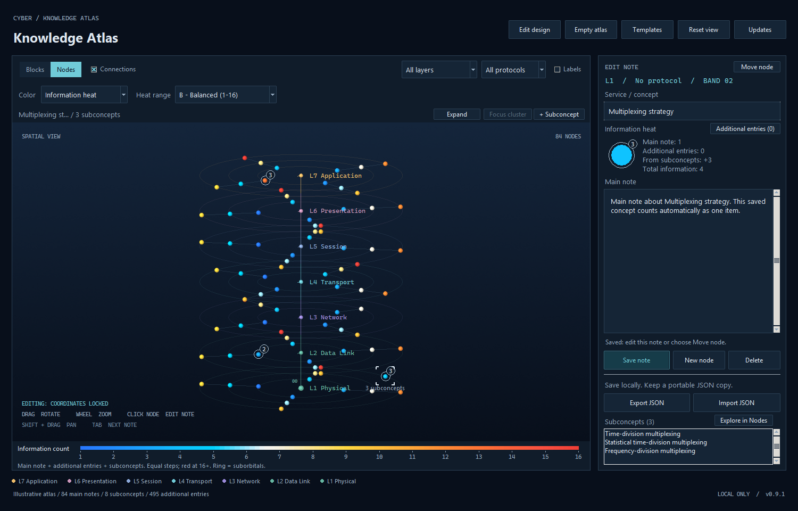

## Install Cyber Atlas

Choose a package for **version 0.10.0**. Each **Download** link downloads the selected file.

| Platform | Package | Installation |
| --- | --- | --- |
| Windows 10/11 (x64) | **[Download installer (.exe)](https://github.com/seiejouke/cyber_atlas/releases/download/v0.10.0/CyberAtlas-0.10.0-Setup.exe)** | Open it and follow the installer. |
| Ubuntu / Debian (x86_64) | **[Download package (.deb)](https://github.com/seiejouke/cyber_atlas/releases/download/v0.10.0/cyber-atlas_0.10.0_amd64.deb)** | Open it with your software installer. |
| Other compatible Linux (x86_64) | **[Download AppImage](https://github.com/seiejouke/cyber_atlas/releases/download/v0.10.0/CyberAtlas-0.10.0-x86_64.AppImage)** | In the file's properties, allow it to run as a program, then open it. |

See the [release notes and checksums](https://github.com/seiejouke/cyber_atlas/releases/tag/v0.10.0) and the [user guide](docs/USER_GUIDE.md#install-and-open) for system requirements and installation details.

---

## Camera navigation and labels

Click **X**, **Y** or **Z** on the compass to align the view; click again for the
opposite side. The layer slider below it selects a visible layer, and **All**
shows the whole atlas. Retract **Navigation** into the **Nav** tab for more space.
Labels follow nodes as you move the camera and settle into free space afterward;
selected and hovered concepts get priority. These controls preserve your notes,
drafts and history. See the [navigation guide](docs/USER_GUIDE.md#orientation-compass).

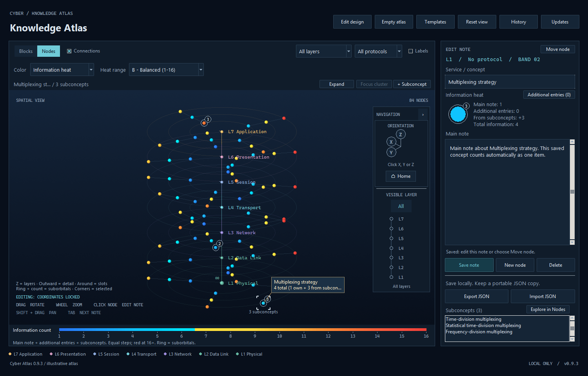

## Editable layer concepts (source)

**Implemented in source; not yet included in the v0.10.0 downloads.** New layers,
new atlases and the Blank template start with an editable concept on each layer's
vertical axis. Click its sphere or layer label to edit its title and notes, add
information or subconcepts, or reference it in FlowNotes. **Edit layer** opens
the layer's naming and ordering controls; the concept stays anchored to its layer.

Older atlases keep their existing center notes. Clicking a layer marker without
a note opens a named draft; **Create node** saves it through the normal save and
history workflow. **New node / Add here** from a central concept starts an
outward concept on that layer.

## Orbital clusters

Select a saved node and choose **+ Subconcept** to create a related type with
independent notes. Each parent supports one ring of eight stable local positions.
**Expand** and **Focus cluster** make the children easy to explore; **Show atlas**
returns to the surrounding map. Moving the parent carries its children along.

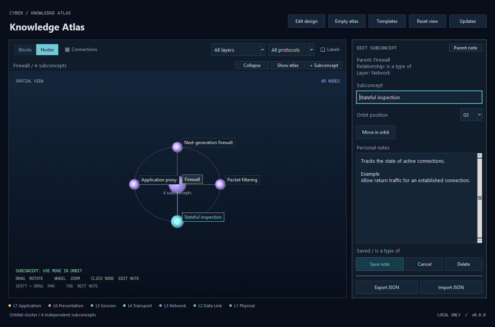

In Blocks view, select a child in **Subconcepts** to edit its notes, or choose
**Explore in Nodes** to open the orbit. Children share their parent's layer and
protocol filters and are included in JSON exports and backups.
Try the [editable orbital-cluster example](examples/orbital_cluster_atlas.json).

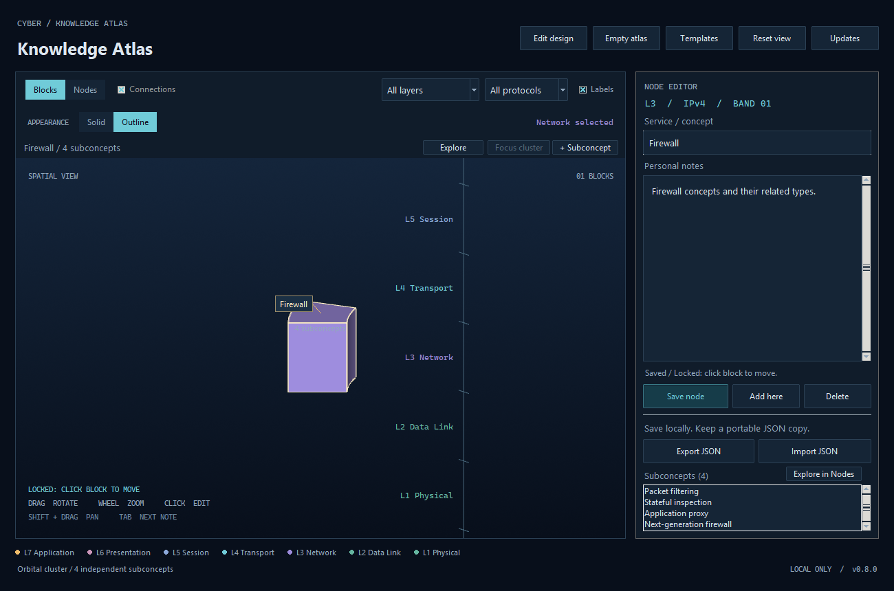

## Information heat

In **Nodes**, choose **Color → Information heat**. Each saved concept's main note counts automatically, and its suborbitals add their own information to the parent. **Balanced (1–16)** is the initial preset; every additional item changes the color until red, using blue → cyan → yellow → orange → red with equally spaced counts. Compact and Extended presets are also available. A neutral ring and count badge identify parents even when their suborbitals are collapsed.

Information heat visualizes **relative information volume**. Information-based
node sizing is a planned extension of this same concept, using the same
recorded-information counts to change node size while preserving node positions.

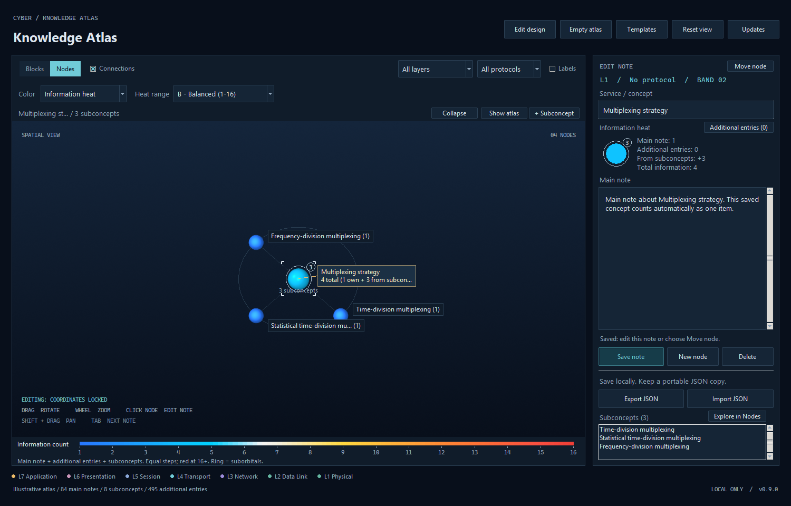

See the [guide](docs/USER_GUIDE.md#information-heat) or try the [main-note heat example](examples/main_note_heat_atlas.json). Existing notes, suborbitals and additional records are preserved; exact copies made by the old main-note copy action count once. No file-format migration is needed for this display change.

## Saved-state history

Choose **History** to browse saved atlas states in a separate read-only 3D view,
inspect earlier notes and deleted suborbitals, or restore a version as a new save.
Recording starts with the existing atlas and a valid previous backup, then captures
successful content changes with timestamps. **Export with history** keeps all
states and their change summaries in a ZIP. Automated timeline playback remains planned.

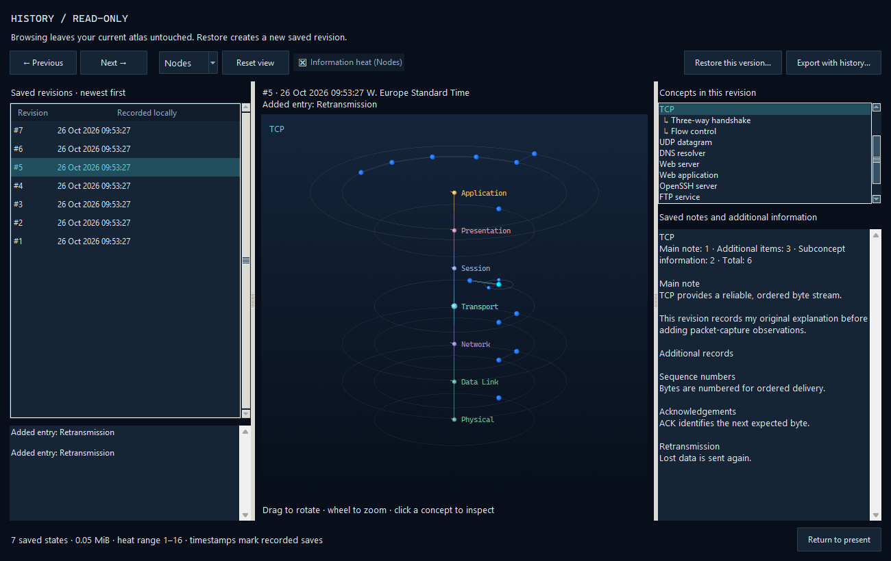

See the [history guide](docs/USER_GUIDE.md#saved-state-history)
and [release verification](docs/history-verification.json).

## FlowNotes

Create saved process guides with **Flows** beside History. Each step references
an existing node or suborbital; labelled arrows can cross layers while every
concept keeps its position and shared notes. The study panel provides readable
notes, clickable concept references, branch choices and manual Previous/Next
navigation. **Focus step** adjusts the camera separately.

FlowNotes is included in **v0.10.0** for Windows and Linux. See the
[FlowNotes guide](docs/USER_GUIDE.md#flownotes),
[release verification](docs/flows-verification.json), or the
[editable packet-flow example](examples/packet_flow_atlas.json).

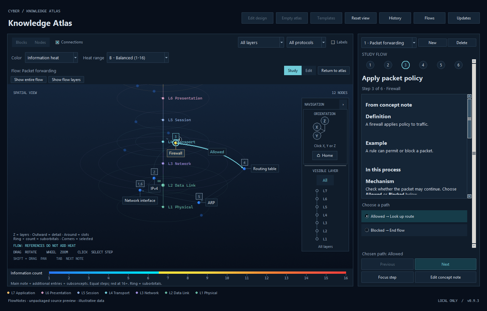

## Project scope and vision

This section contains the complete illustrated design philosophy. The current
release provides the spatial notebook, information heat, saved-state history and FlowNotes;
mastery measurements, assessments, source integration and historical
playback remain planned capabilities. The implementation table below records
what is available today, and the development roadmap sets priorities for future work.

### Contents

- [Product vision](#product-vision)
- [Spatial information model](#spatial-information-model)
- [Ten fundamental design principles](#ten-fundamental-design-principles)
- [Planned feature: multi-atlas workspace](#planned-feature-multi-atlas-workspace)
- [Cumulative source integration](#underlying-requirement-cumulative-source-integration)
- [Four complementary dimensions](#four-complementary-dimensions)
- [Current implementation and planned features](#alpha-implementation-versus-planned-features)
- [Prioritized development roadmap](#prioritized-development-roadmap)
- [Central design philosophy](#central-design-philosophy)

> **Product vision and fundamental architecture**  
> **Development stage:** Alpha · **Reference implementation:** v0.10.0 · **Updated:** 28 October 2026

### Product vision

**Cyber Atlas is a spatial learning companion designed to transform fragmented information into a coherent, interconnected, and progressively consolidated body of knowledge.**

Inspired by the Munsell Colour System and the idea of a digital memory palace, it organizes knowledge within an evolving three-dimensional structure. Rather than merely collecting notes, the atlas aims to communicate **where new information belongs, how it relates to existing concepts, how much information has accumulated, how well it is retained, and how understanding changes over time**.

Its core motivation is **cumulative knowledge integration**: reading a page today, finding a related idea next week, or reading seven books on one topic should contribute to one developing structure instead of seven disconnected note collections. A fragment does not need an immediate connection; it should remain available for future integration.

### Spatial information model

| Dimension or feature | Intended meaning |
| --- | --- |
| **Vertical axis (Z)** | Major knowledge categories or conceptual layers |
| **Radial distance** | Increasing granularity, function, or detail |
| **Angular position** | Deliberate, recognizable spatial placement |
| **Local orbit** | Sibling types or variants grouped around a parent concept |
| **Information heat / outer node shell** | Relative quantity of recorded information, shown through heat colors today, with node sizing planned |
| **Inner node core** | Estimated mastery based on demonstrated retrieval and application |
| **Connections** | Explicit conceptual or structural relationships |
| **Time** | How the atlas and understanding have changed |
| **Source references** | Where a claim or observation originated and what it contributed |

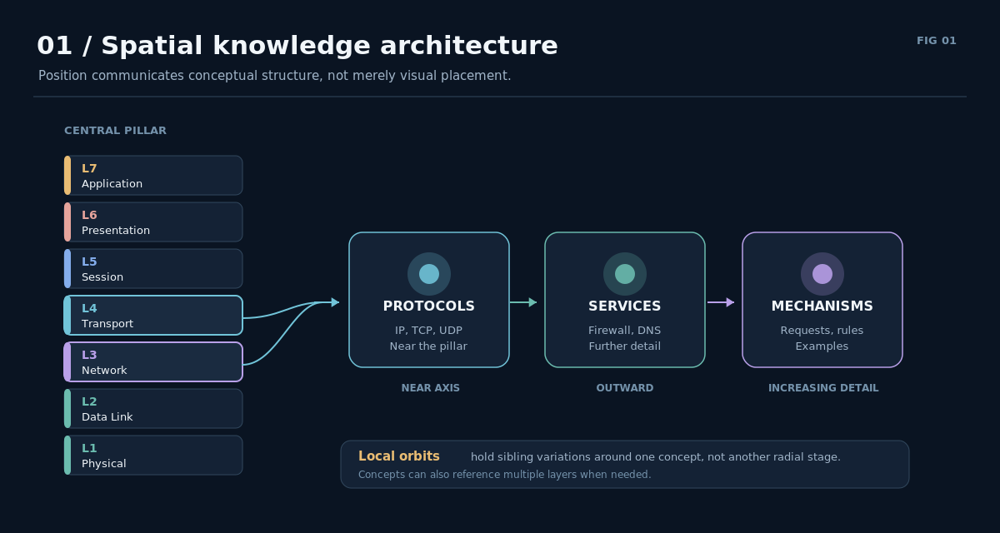

*Figure: Spatial architecture with central conceptual layers and outward radial progression.*

### Ten fundamental design principles

#### 01. Spatial knowledge organization

Concepts occupy meaningful positions in a configurable three-dimensional atlas. An OSI atlas, for example, can use major layers as central pillars, associated protocols as nearby radial concepts, and services or mechanisms farther outward. The same coordinate system should also accommodate Python, mathematics, biology, and other topics.

**Principle:** Spatial position can act as a durable organizational reference and potentially as an additional memory-retrieval cue. A concept may belong to more than one category; the system should support cross-category references rather than forcing an inaccurate classification.

#### 02. Relative information volume: heat and node sizing

Information heat already communicates where a learner has concentrated their study. A concept's main note, additional information entries and direct subconcept contributions determine its heat color. These counts measure recorded items; they do not automatically assess whether differently worded explanations contain distinct information.

Information-based node sizing is a planned extension of the same feature, using the same information counts. Size should use a bounded, nonlinear scaling function so that a few information-heavy nodes do not dominate the atlas, while node coordinates remain stable.

**Principle:** The distribution of recorded information should be legible at a glance, without confusing quantity with competence.

#### 03. Dual-shell knowledge representation

Each node has two independently derived visual states:

- **Outer shell — information:** how much distinct material has accumulated.
- **Inner core — mastery:** the extent to which relevant knowledge has been demonstrated through assessments.

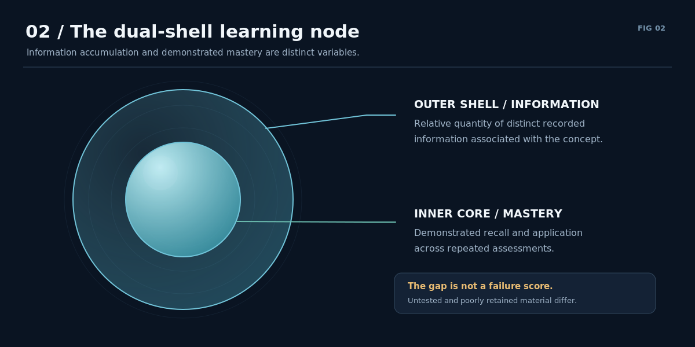

*Figure: Dual-shell node: information volume and independent mastery core.*

The space between them represents content not yet demonstrated as mastered, but this should **not** conflate *untested*, *tested incorrectly*, and *once mastered but now poorly retained*. These may need distinct indications. Adding new notes can grow the outer shell immediately without automatically increasing mastery.

**Principle:** A large knowledge record is not necessarily a well-understood concept.

#### 04. Question-driven knowledge assessment

A node can contain or reference questions tied to specific concepts, explanations, comparisons, and examples. Assessment should eventually cover recall, explanation in the learner's own words, and practical application.

Repeated answers, question coverage, difficulty, and time since review inform an estimated mastery state. An absence of testing is **unknown mastery**, not proof of weak understanding.

**Principle:** The system evaluates demonstrated learning rather than inferring understanding from note length or exposure alone.

#### 05. Adaptive knowledge consolidation

When a large node repeatedly produces weak retrieval results, Cyber Atlas should help the learner diagnose the problem. Two principal options are:

1. **Simplification:** remove redundancy, clarify terms, or restructure explanations while preserving essential meaning.
2. **Decomposition:** split an overloaded topic into smaller, related nodes that can be learned and assessed independently.

Weak answers can also result from missing prerequisites, unsuitable questions, or insufficient review. Structural edits should be recommended, not performed destructively without the learner's consent.

**Principle:** Optimize for understandable and retrievable information, not maximum density or minimum node count.

#### 06. Spatial consistency

Node coordinates should remain recognizable while their content and mastery change. A growing node changes its visual state rather than causing the entire atlas to rearrange itself. If a concept splits into subtopics, the original parent should remain a stable anchor wherever possible.

**Principle:** The atlas may evolve without repeatedly disrupting the user's spatial mental model.

#### 07. Continuous learning feedback

The intended loop is **capture → integrate → expand → assess → consolidate → adapt**, repeated as the learner encounters more information.

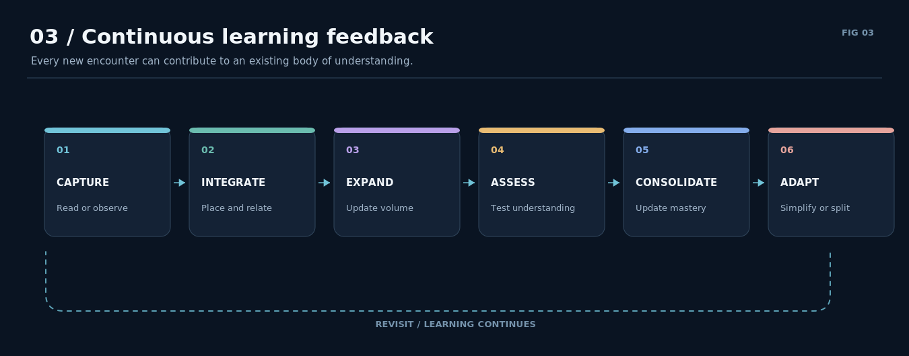

*Figure: Learning loop from capture through adaptation and continued study.*

Assessment results can update mastery estimates and trigger review or restructuring suggestions. New information should be linked to concepts already present instead of automatically creating a new isolated note.

**Principle:** Knowledge accumulation and knowledge consolidation are part of one iterative process.

#### 08. Temporal knowledge evolution

Cyber Atlas should retain an auditable record of meaningful changes and reconstruct the atlas at previous points in time. Users should be able to scrub a timeline or accelerate playback to see new nodes appear, information shells grow, mastery change, and concepts split or become connected.

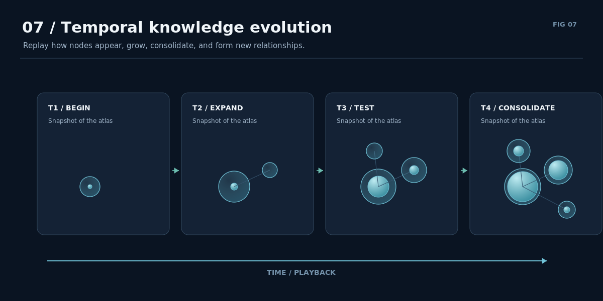

*Figure: Sequence of historical atlas snapshots.*

The long-term implementation could store timestamped events together with occasional snapshots. This is separate from the current one-version backup and should not overwrite historical learning data.

**Principle:** Users should be able to observe not only their current knowledge structure but how it developed.

#### 09. Interactive highlighted notes and guided learning flows

Selecting a node should open a structured, readable study view rather than only unformatted notes. A study view can include definitions, mechanisms, examples, comparisons, and active-recall prompts.

A **single comparative note may reference several atlas nodes**. For example, a note explaining packet-filtering, stateful-inspection, proxy, and next-generation firewalls could let the learner click a type and highlight or focus its corresponding node in 3D. The same content should remain available for editing.

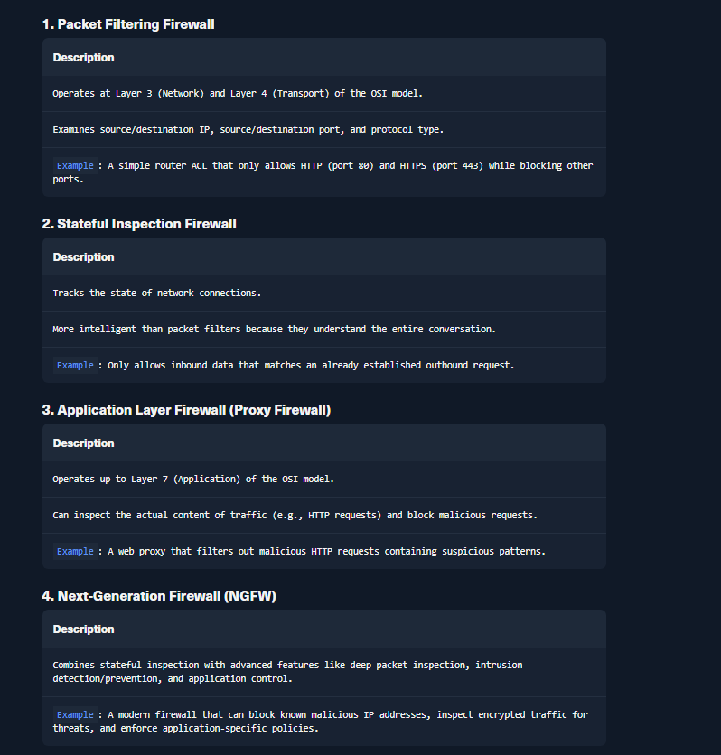

*Figure: User-supplied example of a structured comparative firewall study note.*

**Principle:** A note provides *internal instructional structure*; the atlas provides *external spatial structure*. The two should be interactive and mutually reinforcing.

#### 10. Orbital subconcept clusters

Not all specialization should consume another outward radial position. Cyber Atlas distinguishes:

- **Outward expansion:** progressively deeper mechanisms, services, or levels of detail.
- **Orbital expansion:** close sibling variants or subtypes that share one parent concept.

A **Firewall** node might have four smaller nodes orbiting it: *Packet Filtering*, *Stateful Inspection*, *Application Proxy*, and *Next-Generation Firewall*.

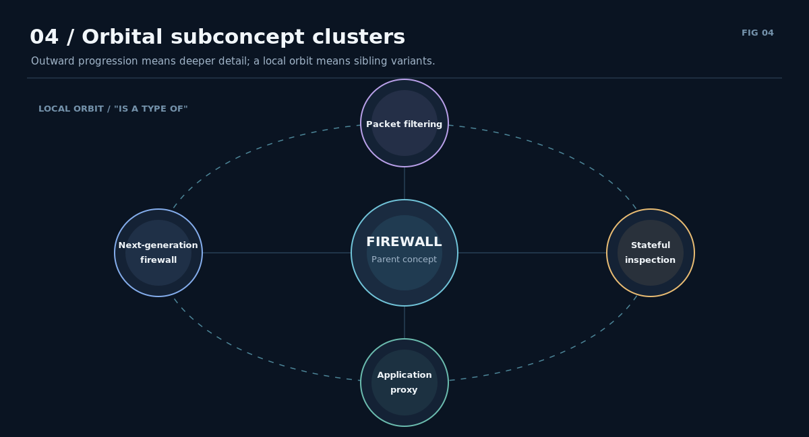

*Figure: Four firewall subtypes orbit a central firewall concept.*

These are **types of firewall**, not four successive radial stages. Their relation to the parent should be explicit in the data model, not inferred solely from proximity. Orbital placement should account for overlap, legibility, and the user's stable spatial memory.

**Principle:** Granularity and categorical variation need distinct spatial representations.

### Planned feature: multi-atlas workspace

**Status: Planned and deferred for a future update; not included in v0.10.0.**

Users should be able to place several complete atlases beside one another in
**one shared 3D viewport**, using one camera and orientation compass. For example,
an OSI atlas and a TCP/IP atlas could stand next to each other, allowing the
learner to explore and visually associate both frameworks at once. Each atlas
keeps its own pillar, layers, protocols, nodes, orbital subconcepts, notes,
information heat and FlowNotes.

An **Atlases** menu would provide:

- **Add empty atlas:** create a named structure with its own editable layers.
- **Add from template:** add another atlas using a built-in template.
- **Import atlas alongside:** add an existing JSON atlas while preserving the
  structures already in the workspace.
- **Manage atlases:** rename, move, focus, hide, solo, export or remove an atlas.

Each atlas should have a selectable nameplate above its pillar. Selecting a
node activates its owning atlas and updates the existing inspector. Layer and
protocol filters apply to the active atlas, identified by name, while other
atlases remain visible. **Focus atlas** frames one structure; **Show all atlases**
frames the complete workspace.

**Move atlas** translates the entire structure as a group, initially along the
horizontal plane with all pillars parallel. Nodes, suborbitals, labels and
FlowNote arrows travel together, preserving their local coordinates. New atlases
receive enough initial spacing for their rings and suborbitals, and saved atlas
positions remain fixed as notes are added.

The workspace should save the complete arrangement, retain its changes in
history, and support exporting an individual atlas. Existing atlas files should
open as a workspace containing one atlas at its original position. Imported
atlases receive distinct workspace identities so files containing identical
internal node IDs can coexist without overwriting notes or breaking references.

**Principle:** Independent knowledge structures can share one navigable space
while retaining their internal organization and stable spatial positions.

### Underlying requirement: cumulative source integration

A learner may read seven books about TCP, encounter the same mechanism repeatedly, and discover contradictory explanations. Cyber Atlas should let those encounters reinforce, extend, clarify, or challenge **one shared concept**.

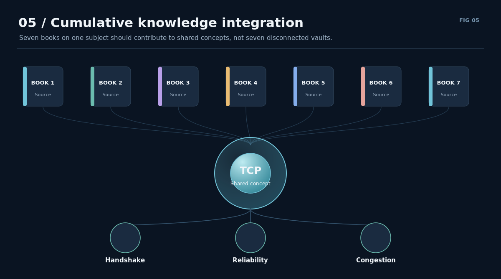

*Figure: Seven books contribute to one shared TCP knowledge structure.*

A useful future information model distinguishes:

| Element | Responsibility |
| --- | --- |
| **Source** | Book, page, article, course, exercise, or observation |
| **Extract** | What was learned from that source |
| **Concept / Node** | The continuing subject represented spatially |
| **Relationship** | How an extract or concept reinforces, depends on, contrasts with, or contradicts another |
| **Assessment** | Evidence of understanding and retention |
| **History** | When contributions and structural changes occurred |

Source count, information volume, and mastery are related but **different quantities**. A learner who records the same fact from seven books has encountered seven sources, not necessarily seven new ideas or seven demonstrations of mastery.

An **inbox / unplaced** state should allow observations to remain accessible before a suitable conceptual relationship becomes clear.

### Four complementary dimensions

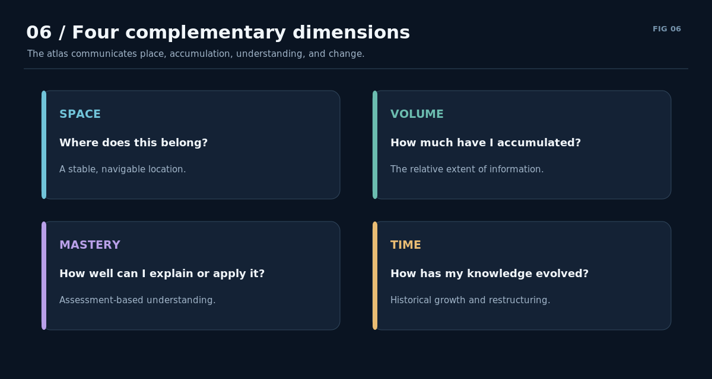

*Figure: Four dimensions: Space, Volume, Mastery, and Time.*

**Space:** Where does this information belong?  
**Volume:** How much distinct material have I accumulated?  
**Mastery:** How much can I demonstrate I understand and retain?  
**Time:** How has that structure and understanding changed?

Sources, relations, assessments, and interactive study notes connect these dimensions into one learning environment.

### Alpha implementation versus planned features

*Published baseline: v0.10.0. Planned capabilities below describe the intended system.*

| Component | Status |
| --- | --- |
| Configurable 3D spatial architecture | **Implemented** |
| [Multi-atlas workspace](#planned-feature-multi-atlas-workspace): add, import and arrange independent atlases in one viewport | **Planned** |
| Blocks and Nodes visualizations | **Implemented** |
| Stable node coordinates and manual movement | **Implemented** |
| Editable central layer concepts with automatic creation and clickable layer labels | **Implemented in source** — pending a packaged update |
| Clickable orientation compass with six axis views | **Implemented** |
| Retractable navigation panel and synchronized layer slider | **Implemented** |
| Stable node and suborbital labels with selection priority | **Implemented** |
| Editable layers, protocols, labels, and templates | **Implemented** |
| Local notes, JSON import/export, atomic saves, one-version backup | **Implemented** |
| Beginner and intermediate construction tutorials | **Planned** — a user guide and editable examples are already available |
| Selectable light/dark themes | **Planned** — the current interface uses a fixed dark palette |
| Advanced custom themes | **Planned** |
| Windows and Linux release packaging | **Implemented** |
| Opt-in release checks and verified update downloads | **Implemented** |
| Node connections between footprints sharing an edge; gaps remain unconnected | **Implemented** |
| Relative information volume: recorded entries, heat colors and information-based node sizing | **Heat implemented; sizing planned** as an extension using the same information counts |
| Automatic main-note heat, linear presets and persistent parent indicators | **Implemented** |
| Dual-shell mastery visualization | **Planned** |
| Node-associated question bank and assessment history | **Planned** |
| Guided interrogation | **Planned** — FlowNotes already supports authored recall prompts |
| Source-aware integration and typed relationships | **Planned** |
| Adaptive simplification and decomposition suggestions | **Planned** |
| Saved-state recording, read-only history browsing and restore | **Implemented** |
| Animated timeline playback and scrubbing | **Planned** |
| FlowNotes, manual process arrows, branch choices and shared study content | **Implemented in v0.10.0** |
| Interactive comparative study notes | **Partial in v0.10.0** — FlowNotes provides a structured reader and clickable concept references; a standalone study-note view remains planned |
| Orbital subconcept clusters | **Implemented** — one ring of eight stable positions, independent notes, Nodes expansion and Blocks child list |
| Scalable subconcept architecture beyond the current eight-position ring | **Planned** |

The present alpha establishes the spatial notebook. The envisioned learning mechanisms, including mastery estimates and the proposed memory benefits of spatial association, still require implementation and validation with actual learners.

### Prioritized development roadmap

The following priorities combine usability, learning and architecture work with
the existing feature plans. The implementation table above records current
availability; these priorities guide future development.

| Priority | Development task | Scope and purpose |
| --- | --- | --- |
| **1** | **Usability testing and UI refinement** | Establish whether people can use the existing application independently. Observe creating an atlas, arranging concepts, adding subconcepts, building FlowNotes, saving and recovering work; use observed difficulties to guide UI changes. |
| **2** | **Beginner and intermediate tutorials** | Make conceptual and procedural construction accessible. Guide beginners through a small conceptual atlas, then cover organizing a larger topic, comparing concepts and constructing a procedural FlowNote. Build on the existing user guide and editable examples. |
| **3** | **Scalable subconcept architecture** | Extend orbital clusters beyond the current eight-child, single-ring limit while preserving recognizable positions, readable labels and straightforward navigation. Additional rings, nesting and other approaches need a separate design decision. |
| **4** | **Performance profiling and optimization** | Establish practical limits by measuring loading, saving, camera interaction, labels, expanded clusters, history and FlowNotes at increasing atlas sizes. Use the results to prioritize improvements before extensive expansion. |
| **5** | **Selectable light/dark themes** | Improve accessibility and usability through a consistent theme system covering controls, notes and the viewport. Extend the existing dark palette while preserving readable selection states and meaningful heat colors. |
| **6** | **Guided interrogation and assessment** | Build on reliable conceptual notes and procedural FlowNotes with prompts for recall, explanation, comparison and tracing processes. Introduce guided questioning first, then concept questions, recorded answers and assessment history. |
| **7** | **Advanced custom themes** | Add personalization through custom palettes and appearance settings, extending the theme system from priority 5 while preserving readable controls and information displays. |

Baseline performance measurements should begin during priorities **1–2**, before
expanding the subconcept architecture. Priority **4** remains the dedicated
profiling and optimization milestone. Usability findings should inform later
work and tutorial revisions.

Existing feature plans fit into this roadmap as follows:

| Planned capability | Placement and dependencies |
| --- | --- |
| [Multi-atlas workspace](#planned-feature-multi-atlas-workspace) | A separate expansion milestone after scalability and performance work. It needs its own workspace model and saving behavior alongside shared navigation and rendering. |
| [Source integration, typed relationships and an unplaced inbox](#underlying-requirement-cumulative-source-integration) | A separate knowledge-organization milestone, beginning with sources and extracts linked to concepts, then extending relationships. Basic guided questioning can proceed independently. |
| Information-based node sizing | An extension of implemented information heat, using the same information counts. Introduce it after evaluating spatial readability and performance, while preserving node positions. |
| Standalone comparative study notes | Part of priority **6**, building on the existing FlowNotes reader and clickable concept references. |
| Dual-shell mastery visualization | A later stage of priority **6**, after assessment results are available and the mastery model is defined. Untested knowledge, incorrect answers and declining retention need distinguishable states. |
| Adaptive simplification and decomposition suggestions | Follow assessment and mastery work, using recorded difficulties to support suggestions. The learner controls any resulting structural changes. |
| Timeline playback and scrubbing | An independent extension of implemented saved-state history. It remains a later milestone without blocking the main learning workflow. |

Licensing, signing and platform distribution are tracked in the
[distribution checklist](docs/DISTRIBUTION.md).

### Central design philosophy

**Every piece of information should have the opportunity to contribute to a greater whole — and that whole should remain spatially understandable as it grows.**

In Cyber Atlas, a node is not merely a note. It is a spatially located concept that can gather information from multiple sources, develop subtypes and relationships, support questions, reflect demonstrated mastery, and reveal its own evolution over time.

The ultimate objective is not to maximize the quantity of notes. It is to help learners **integrate fragmented information into coherent, accessible, and increasingly well-retained understanding**.

---

**Project:** [seiejouke/cyber_atlas](https://github.com/seiejouke/cyber_atlas)  
**Reference release:** [v0.10.0](https://github.com/seiejouke/cyber_atlas/releases/tag/v0.10.0)\
**Document:** Conceptual product specification; not a claim of scientific efficacy or completed functionality.
