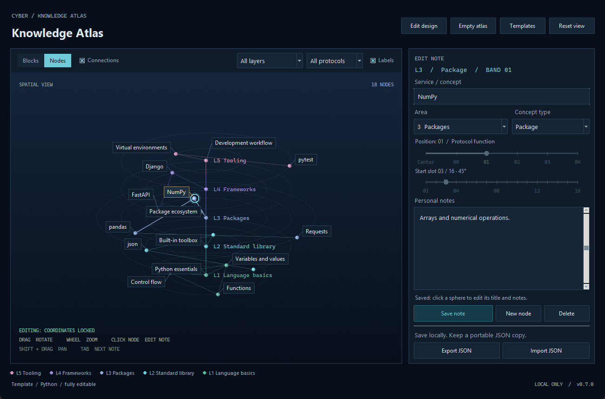
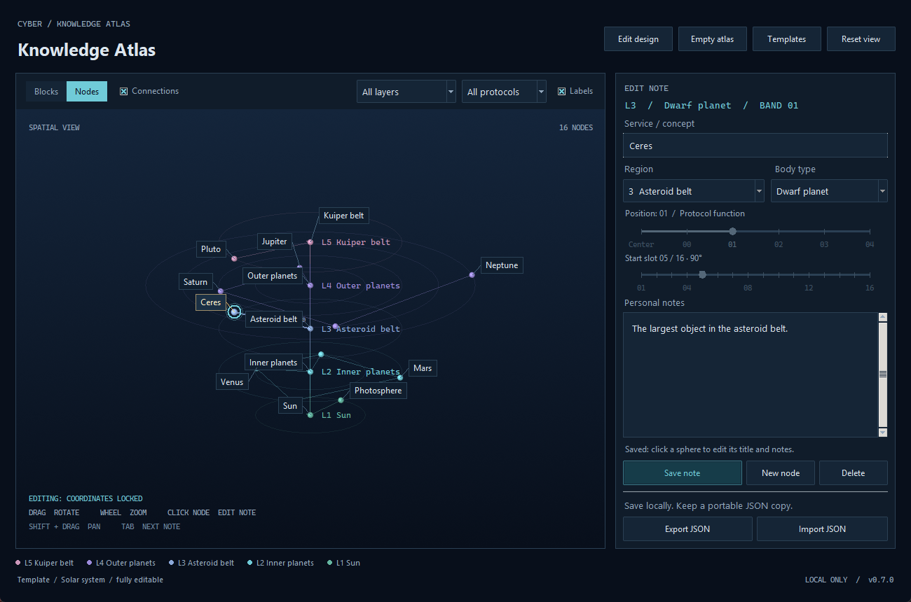

# Cyber Atlas user guide

[Download and overview](../README.md) | [Developer guide](DEVELOPMENT.md)

## Install and open

Download the Windows installer from the [latest release](https://github.com/seiejouke/cyber_atlas/releases/latest),
run it, and open Cyber Atlas from the Start menu. The installer includes Python,
Tk and VTK. Windows 10/11 x64 and a working OpenGL graphics driver are required.

For the ZIP version, extract the whole archive and open `CyberAtlas.exe`.
Keep its `_internal` folder beside it. Both versions use the same saved atlas
location described below; updating or uninstalling preserves your atlas.

On Linux x86_64, download `cyber-atlas_0.8.0_amd64.deb` for Ubuntu/Debian-based
desktops and install it with your package installer. Open **Cyber Atlas** from
the application menu. Python, Tk and VTK are included.

For other compatible Linux desktops, download `CyberAtlas-0.8.0-x86_64.AppImage`.
In the file's properties, allow it to run as a program, then open it. The AppImage
is portable; it does not install an application-menu entry automatically.

The Linux build requires glibc 2.35 or newer, a compatible C++ runtime, and a
working OpenGL driver. Tk uses X11, or XWayland on Wayland desktops. If your
system cannot mount AppImages, see the [AppImage FUSE guide](https://docs.appimage.org/user-guide/troubleshooting/fuse.html).
Linux notes are stored in `~/.local/share/CyberAtlas` unless `XDG_DATA_HOME` is set.
Installing or removing either package preserves those notes.

## Updates

Open **Updates** to check GitHub for a newer stable release and read its changes.
Nothing is downloaded until you choose **Download update**. Each package is
checked against the release's SHA-256 digest before it can be applied.

On Windows, an installed copy offers **Restart and update** after the download.
Save, discard, or cancel any unsaved note changes. The updater closes this copy,
upgrades its existing installation, and reopens the same atlas. Other Cyber Atlas
windows must be closed before the update can proceed; the updater does not force
them to close. The Windows ZIP and source versions open the release page for
manual updates instead.

An AppImage can replace itself in a writable location and restart with the same
atlas. Its previous version is kept beside it with a `.previous` suffix. If the
new process cannot start, the previous file is restored. A Debian installation
offers **Open installer** to open the verified package in the system software
installer; finish there and reopen Cyber Atlas.

**Check automatically once a day** is off by default. Enabling it saves that
preference separately from your atlas and allows background release checks.
Available updates open a notification window; downloads and installation still
require your choice. Offline or failed checks leave the application usable.

Users of 0.7.1 or earlier need one manual upgrade to receive this update checker.
The first implementation downloads the full package and upgrades it in place.

## Orbital subconcepts

Select a saved node and choose **+ Subconcept** in the cluster bar above the
viewport. Give the child a title and its own notes, choose an available local
orbit position, and **Save note**. The relationship is **Is a type of**: for
example, Firewall can contain Packet filtering and Stateful inspection.

One parent supports up to eight children on one ring. Children inherit the
parent's layer and protocol; they do not reserve additional grid slots. Adding
a child fills a free local position without moving its siblings. Nested orbits
and converting existing grid nodes into children are not included in this version.

In **Nodes**, **Expand** opens the orbit and frames the cluster. Click a child
sphere or label to edit its independent notes. **Move in orbit** unlocks its
local position. Occupied positions cannot be saved. **Cancel move** or Escape
restores the saved position while keeping text edits; **Save note** commits the
new position. Switching notes or leaving a changed child asks Save/Discard/Cancel.

**Focus cluster** temporarily hides unrelated nodes and frames the orbit.
**Show atlas** restores the previous camera and surrounding nodes. **Collapse**
hides the orbit. Saved grid positions remain unchanged. Moving the parent uses
the normal movement controls and carries all its children along. Layer and
protocol filters apply to the complete cluster.

In **Blocks**, the existing parent footprint remains visible. The editor lists
its children under **Subconcepts**, with a scrollbar for larger clusters. Select
a child to edit its notes, or **Explore in Nodes** to see its orbit. A parent's
position controls are collapsed while its child list is displayed; in Nodes
choose **Move node**, or in Blocks click the selected block to place it elsewhere.

Deleting a child preserves its parent and siblings. Deleting a parent explicitly
asks to delete the whole cluster, including all child notes. The normal
previous-version backup includes the complete cluster. JSON export/import also
preserves every child ID, parent link, local position, relationship and note.

Import `examples/orbital_cluster_atlas.json` for an editable four-child Firewall
example. See the [implemented cluster screenshots](../README.md#orbital-clusters).

## First use

The first launch creates a local atlas containing the 14 starter notes from
the HTML concept. Blocks support coordinate editing; clicking a sphere in
Nodes opens its title and personal notes. **Move node** unlocks its position controls.

Click **Templates** to preview a general-purpose example in the actual Nodes
renderer. The built-in topics are Blank atlas, Python, TypeScript, Web
application, Solar system and Project planning. A preview is read-only and is
never saved automatically. **Cancel** restores the open atlas, editor, filters,
view and camera; **Use template** saves an editable copy and keeps the previous
saved atlas as the normal backup. The template list contains text only; every
visible sphere and connection comes from the real atlas document being previewed.

| Python template | Solar System template |
| --- | --- |
|  |  |

Use the **Blocks / Nodes** switch to change the view. Nodes draws one small,
equally sized sphere per note, using its layer color and saved layer, radial
position and start slot. Faint orbital guides appear only for occupied,
visible rings; guides cannot be selected. A cyan halo marks the selected note.
Nodes shows labels on hover or selection by default; enable **Labels** to
show all labels that fit. Custom label formats and optional protocols work
in both views.

Enable **Connections** beside Blocks/Nodes to link adjacent visible spheres.
Lines use their layer color; selected-node links are brighter. Create a center
node with **New node** and the radial slider's **Center** stop; its saved sphere
then selects and edits like any other node. The vertical spine stops at the
first and last center nodes.
Connections are derived from saved positions and are not stored in JSON.

Blocks starts in **Outline** appearance: the selected block is solid and the
other blocks have colored outlines. Blocks on the selected layer have brighter
outlines and labels; hovering another block highlights it and reveals its label.
Click an outline, its interior, or a label to select the block. The selected
solid hides geometry behind it. Choose **Solid** in the Appearance bar to fill
all visible blocks. Appearance changes preserve notes, placement drafts and
the camera; they last for the current session and do not change the JSON file.

Import [the architecture example](../examples/architecture_atlas.json) to explore
15 concepts across Interface, API, Services, Data and Operations layers.

Switching views preserves the camera, filters, notes and current draft. The
view choice lasts for the current session and does not change saved or exported
atlas data.

[See Nodes view](nodes-preview.png).

Import `examples/nodes_view_atlas.json` to explore a demo with 42 editable
notes distributed across all seven layers.

To start fresh, click **Empty atlas** in the top bar. The app checks for
unsaved edits and asks before replacing any saved blocks. It saves an empty
atlas and keeps the previous saved atlas in the normal backup. Export JSON
first if you want a separate lasting copy. Clicking Empty atlas again while
it is already empty preserves that backup. Your custom design is kept.

Click **Edit design** in the top bar to customize the atlas:

- **Layers:** add, rename, recolor, remove, or move a layer higher/lower. The
  list shows the top layer first. Axis names, colors, filters, legend and
  camera adapt to the new order and count. Layers remain equally spaced.
- **Protocols:** add, rename or remove your own protocol entries.
- **Field names & labels:** change the default **OSI layer** and **Protocol**
  captions, and choose **Title only**, **Layer + protocol**, or
  **Title + layer + protocol** on block labels.

Select an entry and edit its name/color. **Update entry** updates the design
draft; switching entries or clicking **Apply design** also keeps those edits.
**Apply design** saves the complete design and updates the atlas. **Cancel**
discards pending design edits. Removing an individual entry used by blocks asks you to
choose a replacement. A reassignment that would overlap blocks is rejected;
move those blocks to free slots before combining their layers.

To rebuild layers: **Remove list → Add layer → Update entry → Reassign
blocks… → Apply design**. Apply stays disabled until every existing block has
a layer. A merge that puts blocks in the same slot is rejected; keep more
layers or move those blocks to free slots first.

Example: after removing the OSI layers, add **File System**, then map each
removed layer to it under **Reassign blocks…**. If the merge overlaps, add
more replacement layers and split the assignments. Blocks and notes are never
discarded automatically.

**Remove protocols** saves immediately and changes existing blocks to **No
protocol**. Adding **Directory**, for example, creates an available protocol
but does not assign it to those blocks; assign it from each node editor as
needed. **Layer field name** and **Protocol field name** change captions only,
not entries or assignments.

Renaming and reordering keep every block attached through stable IDs. The
design is included in saved/exported JSON. A design supports 1–64 layers and
0–256 protocols, including a completely custom set without OSI entries.

[See the design editor](design-editor.png).

In **Nodes**, press **New node**, choose its layer and protocol from the
dropdowns, and choose its radial position and start slot with the sliders. The
preview updates immediately; **Create node** saves a valid position. Occupied
positions turn red and disable creation. Clicking empty space does nothing.
Clicking a saved sphere opens its title and personal notes for editing. Choose
**Move node** above the editor to change its **Layer**, radial **Position** and
**Start slot**. A live outline previews the destination; occupied positions turn
red and disable **Save move**, including reservations hidden by filters. The
preview remains visible when its destination is outside the current layer filter.
**Save move** saves the new position and any text edits. **Cancel move** or
**Escape** restores the starting coordinates while keeping title and note edits.
Moves keep the same node ID, protocol and block size, including when moving
between Center and a ring. A full-size node still needs an entirely free ring.
An unsaved move survives switching between Blocks and Nodes; both views show
the saved position. Drag and wheel continue to rotate, pan and zoom the view.

In **Blocks**, the spatial workflow remains:
**Add here -> choose size -> move the preview -> left-click to lock -> write your note -> Save node.**

Add here keeps the current layer, protocol and radial position, and finds
the next free space around that ring. New blocks default to **1/16 (22.5
degrees)**. Your last explicitly chosen size is remembered between additions
during the current session, even when you select a differently sized block.
In Nodes view, **Block size** is hidden and newly added radial notes use **1/16**,
regardless of the remembered Blocks size. Existing notes keep their saved
size: a wider block still reserves its original slots, shown by the Start
slot slider's footprint, even though every sphere has the same marker size.
Center nodes use **Full** automatically so their sphere sits on the layer axis.
Switch back to Blocks to see those saved dimensions.

Each ring has 16 angular slots. A **1/16** block occupies one slot, **1/8**
occupies two adjacent slots, **1/4** occupies four, **1/2** occupies eight,
and **Full** occupies all sixteen. Sizes can be mixed. Start slot is numbered
**01-16**; a block can wrap from slot 16 back to slot 01.

**Start slot is a slider**, with 16 snapping stops and labels at 01, 04, 08,
12 and 16. Its heading shows the exact slot and angle, such as **Start slot
07 / 16 · 135°**. Highlighted stops show the block's whole footprint, while
red stops mark starts that would overlap another block at the chosen size.
Wrapping footprints highlight both ends and show **Slots 16 → 01**.

In Nodes, dragging this slider updates the creation or movement preview;
**Create node** or **Save move** saves it. In Blocks, releasing a valid slot
locks the preview. Releasing on a blocked slot keeps it red and disables saving. Left/Right step one slot;
Home/End select the first/last slot.

Existing blocks stay fixed. Deleting leaves an empty gap that can be reused.
Resizing grows or shrinks the selected block clockwise from its start slot.
A resize or move that overlaps another block is rejected without saving.
If a ring has no suitable space, Add here reports that it is full for that
size; it keeps the current radial depth. Choose another size or position.

Block placement has two states, shown in the editor and viewport:

- **Placing:** Add here starts a preview that follows the mouse on the editor's
  current OSI layer. A cyan outline shows a valid position; red indicates an
  overlap. **Left-click a valid location to lock it.** Occupied locations do
  not lock. Dragging still rotates the view.
- **Locked:** Mouse movement and unrelated empty clicks leave the draft in
  place. **Click the locked block again to pick it up**, then left-click its
  new location to lock it again. **Escape** cancels the move and restores its
  last locked position, keeping its title and notes.

For a saved block, click to select it and click the selected block again to
pick it up. Moving changes the draft; **Save node** commits the position and
notes. Save is disabled while Placing, so it cannot save a different location
from the moving preview. The Start slot slider also locks a valid position
on release, providing an alternative to clicking in the viewport.

You can also click empty space with a saved block selected to start a new
draft at that spot. Filtering to the editor's OSI layer makes placement
easiest. Selecting a different saved note still checks for unsaved edits.

Choose **Center** in the position control to create an ordinary block at the
axis. Center blocks have the same size, start-slot, editing and saving
behavior as other blocks. A 1/16 center block occupies a small slice of the
disk; Full fills the disk when explicitly chosen. Center blocks are optional.

The position control has six equally spaced stops: **Center, 00, 01, 02, 03,
04**. Click a stop or label, drag, or use the arrow keys to move along the
radial positions. **Save node** commits the move.
Moving a block keeps its size and start slot and leaves its old space empty.
The editor shows the block's angle and available slots at its destination.

Use the layer and protocol dropdowns to filter the view. Filters keep the
saved block sizes and positions intact. The Labels checkbox controls
annotations, not the notes themselves; in Nodes, hover and selection labels
remain available when it is unchecked. Labels that would overlap or belong
to obscured surfaces are omitted to keep the view readable. The selected note
is prioritized. You can still rotate the map, filter a layer, or use Tab to
reach a note whose label is hidden.

Filters affect only the view. They do not delete data or change the note in
the editor. Saving a note outside an active filter clears that filter so the
saved volume is visible.

## Controls

| Action | Control |
| --- | --- |
| Change the representation | Blocks / Nodes switch; keeps the same atlas and current draft |
| Show or hide node links | Connections checkbox in Nodes view |
| Rotate the atlas | Left-button drag |
| Pan | Shift + drag, or middle-button drag |
| Zoom | Mouse wheel; `+` / `-` with viewport focused |
| Edit a node's title and notes | Click a saved sphere or its label |
| Move a saved node | In Nodes, select a sphere, choose Move node, adjust layer/position/start slot, then Save move |
| Create a node | New node, then use the dropdowns and sliders; Create node saves it |
| Lock a moving block | In Blocks, left-click a valid location |
| Pick up a locked draft or selected block | In Blocks, left-click the block again |
| Cancel a move | Cancel move or Escape restores a Nodes move's starting coordinates and keeps text edits; other Blocks moves use Escape to restore the last locked position |
| Place a new block | In Blocks, Add here, then click to lock on the selected layer |
| Choose block size | Block size dropdown in Blocks view; Save node commits a resize |
| Set the start slot | Drag the slider or use Left/Right and Home/End; Nodes previews, Blocks locks on release |
| Reset the camera | Reset view, or `R` in the viewport |
| Rotate using keys | Arrow keys in the viewport |
| Next / previous visible note | Tab / Shift + Tab in the viewport |
| Move from viewport to editor | Enter |
| Select Center or a radial band | Click or drag its slider; left/right keys when focused; Home/End for first/last |
| Save or create | Ctrl + S |
| Start a new node/block | New node or Add here, or Ctrl + N |
| Start with no blocks | Empty atlas in the top bar |
| Preview an editable example | Templates in the top bar; select a topic, then Use template |
| Customize layers, protocols, field names and labels | Edit design in the top bar |
| Import JSON | Ctrl + O |
| Export JSON | Ctrl + Shift + S |

## Saving and recovery

**Save node, Save note and Save move immediately write the atlas to disk.**
Apply design, confirmed Remove protocols, deletions and successful imports also save immediately.
Text still being typed is a draft: it is
not saved on every keystroke. Before selecting another note, creating a new
one, importing, or closing, the app asks whether to save a changed draft.

Default data locations:

| System | File |
| --- | --- |
| Windows | `%LOCALAPPDATA%\CyberAtlas\atlas.json` |
| Linux | `~/.local/share/CyberAtlas/atlas.json` (or under `$XDG_DATA_HOME`) |
| macOS | `~/Library/Application Support/CyberAtlas/atlas.json` |

Writes use a temporary file and atomic replacement. The previous valid
version is retained as `atlas.json.bak`. If the active atlas becomes unreadable
and a valid backup exists, startup offers recovery and preserves the unreadable
original as a timestamped `.broken-...` file.

This backup is **one previous version**, not unlimited undo or a separate
backup strategy. Export named JSON copies for milestones. Use only one app
window per atlas; this is not a concurrent multi-user editor.

The JSON is readable plaintext, not encrypted storage. Do not put passwords,
recovery codes, or other secrets in these notes.

### Portable files and the original HTML prototype

Export JSON saves a complete portable copy. Import JSON **replaces** the active
atlas after confirmation; it does not merge atlases. Malformed files and
duplicate IDs and overlapping blocks are rejected without partially importing
a document.

The importer supports the earlier HTML prototype's JSON versions 1, 2 and 3,
as well as desktop versions 4–9. Older files retain every note's ID,
layer, protocol, depth, notes and list order. Versions 1–5 become compact
1/16 blocks in consecutive slots at each layer/depth; versions 6–7 retain
their exact sizes and slots. Versions 1–6 receive the OSI design preset;
version 7 keeps its custom design. Legacy integer node IDs become strings.
The next save or export writes version 9
with the design and explicit size/slot coordinates; the first save retains
the original file as the normal previous-version backup. Empty atlases can
be imported/exported with their custom design.

Version 8 introduced an empty protocol list (`"protocols": []`) and unassigned
blocks (`"protocol": null`). Existing version 7 files load with their saved
protocol assignments intact. Version 9 adds a separate `subconcepts` list;
existing grid coordinates remain unchanged, and the first save retains the old
file as the normal backup. Files saved by 0.8.0 require that version or newer;
older applications do not support the new file format.

A legacy ring with more than 16 notes cannot fit this grid. Import/loading
stops with a message identifying the ring, without dropping notes or changing
the source file. Move some notes to other depths in the older application
before importing that file.

Use a different working file from the command line:

```bash
python main.py --file my-atlas.json
```

Start with no example nodes in a **new** file:

```bash
python main.py --file my-empty-atlas.json --empty
```

`--empty` never clears a file that already exists. The examples folder also
contains a fresh starter atlas, an empty atlas, and `fixed_slots_atlas.json`
demonstrating mixed 1/8 and 1/16 blocks, a center block, and reusable empty space.
`custom_design_atlas.json` demonstrates custom layers/protocols, field names,
colors and combined block labels.
`no_protocols_atlas.json` demonstrates the same blocks with no protocols.
